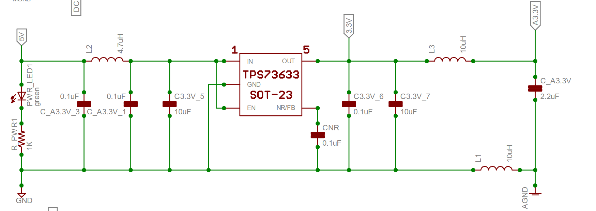

# 3.3V Voltage Regulation Circuit

## 1. Overview

coverts the output of the 5v voltage regulator and converts it itno 3v3, TPS73633, a Low-Dropout (LDO) linear voltage regulator.

The circuit provides two supply domains:

- 3.3V: Main regulated 3.3V supply.
 - A3.3V: Filtered 3.3V supply intended for sensitive analog circuitry.

## 2. IC's Overview

### Constant 3v3 even under low/high loads

maintains a fixed 3.3V output even when its input voltage changes, provided that the input remains within the operating limits

### disadvantage : Excessive volatage is dispatched as heat

Unlike a switching regulator, an LDO dissipates the excess voltage as heat.

In our case :
$$
P_{LOSS}=(V_{IN}-V_{OUT})\times I_{OUT}
$$

For our circuit:

$$
V_{IN}=5V
$$

$$
V_{OUT}=3.3V
$$

If the connected electronics consume 100mA:

$$
P_{LOSS}=(5-3.3)\times0.1
$$

$$
\boxed{P_{LOSS}=0.17W}
$$

### Dropout Voltage

An LDO needs a certain voltage difference between its input and output to maintain regulation.
This minimum difference is called the Dropout Voltage.

The relationship is:

$$
V_{IN}\geq V_{OUT}+V_{DO}
$$

For our 3.3V output:

$$
V_{IN}\geq3.3+0.075
$$

$$
V_{IN}\geq3.375V
$$

Our circuit receives 5V, giving it:

$$
5-3.3=1.7V
$$

So there is a huge gap between the input and the output voltage

If the input voltage gets too close to the output voltage, the regulator eventually loses its ability to maintain 3.3V, and the output begins to drop.

## Enable pin (EN)

connected to VIN waking up the IC

## Noise Reduction (NR)

This is a Noise Reduction pin

A capacitor is connected between NR and GND.

Our circuit uses:

$$
C_{NR}=0.1\mu F
$$

## current limitations
400 mA of max current exessive currents = high temps

## thermal protection

If the junction temperature becomes excessively high, the regulator shuts down to protect itself.

Once the temperature falls sufficiently, it can resume operation.

# Output capacitors

Our circuit uses:

- 0.1µF capacitor for high frequency bypassing.
- 10µF capacitor for additional output decoupling.

## Component Explanation

| Component | Value | Purpose | Explanation |
|:---|---:|:---|:---|
| LED_D1 | Green LED | Power indicator | Indicates that the incoming 5V supply is present. |
| R_PWR1 | 1kΩ | LED current limiting | Limits the current flowing through the power indicator LED. |
| L2 | 4.7µH | Input filter | Works with the input capacitors to filter noise entering the regulator. |
| C_A3.3V_3 | 0.1µF | Input bypass | Filters high-frequency noise on the incoming 5V supply. |
| C_A3.3V_1 | 0.1µF | Input bypass | Provides additional high-frequency filtering close to the regulator input. |
| C3.3V_5 | 10µF | Input decoupling | Provides local charge storage and helps reduce input voltage fluctuations. |
| CNR | 0.1µF | Noise reduction | Filters internal reference noise through the NR pin. |
| C3.3V_6 | 0.1µF | Output bypass | Filters high-frequency noise on the 3.3V output. |
| C3.3V_7 | 10µF | Output decoupling | Provides additional charge during sudden changes in load current. |
| L3 | 10µH | Analog supply filter | Filters the 3.3V supply before it reaches the analog supply domain. |
| L1 | 10µH | Analog ground filter | Forms part of the filtering network between GND and AGND. |
| C_A3.3V | 2.2µF | Analog supply capacitor | Provides local decoupling between A3.3V and AGND. |

# Seperation of A3v3 and AGND

There are 2 different nets such as:
- 3.3V and GND
- A3.3V and AGND

### why seperation for Analog?
The main 3.3V supply is connected to the analog supply through L3.
Similarly, the ground return is connected through L1.
A 2.2µF capacitor is placed between A3.3V and AGND.
Together, these components form an additional filtering network for the analog supply.

Sensitive analog circuits can be affected by electrical noise generated by digital electronics, motors and switching power supplies.

Filtering the supply and its return path helps reduce the amount of unwanted noise reaching sensitive analog circuitry.